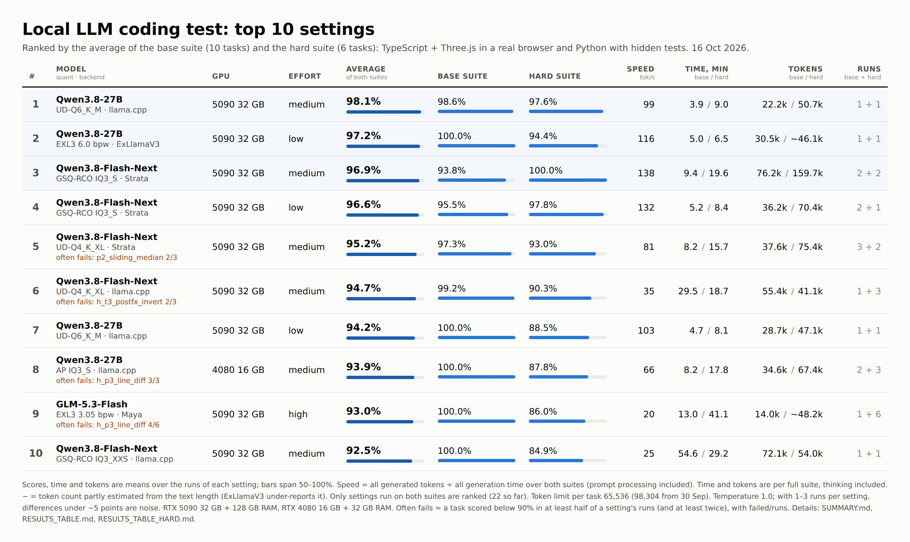
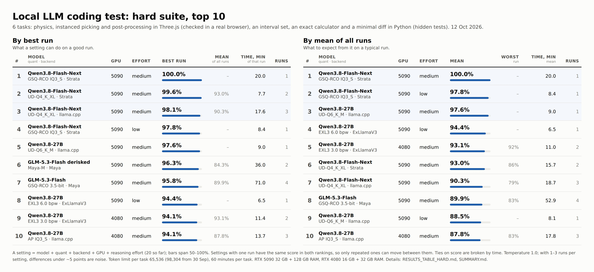

# llm-code-eval — a quick coding test for local LLMs

The repository has four test suites, kept apart everywhere:

| | Base | Hard | Practical | Tools |
|---|---|---|---|---|
| Tasks | 10: 6 × TypeScript + Three.js, 4 × Python ([tasks.py](tasks.py)) | 6: 3 × Three.js, 3 × Python ([tasks_hard.py](tasks_hard.py)) | 6 everyday jobs: edit, bug fix, refactor, SQL, JSON, long context ([tasks_practical.py](tasks_practical.py)) | 7 tool-calling tasks incl. a small coding agent ([tasks_tools.py](tasks_tools.py)) |
| Run with | `--suite base` (default) | `--suite hard` | `--suite practical` | `--suite tools` |
| Default limits | lenient (comparable with older runs) | lenient | practical | practical |
| Raw results | `results/` | `results_hard/` | `results_practical/` | `results_tools/` |
| Tables | [RESULTS_TABLE.md](RESULTS_TABLE.md) | [RESULTS_TABLE_HARD.md](RESULTS_TABLE_HARD.md) | [RESULTS_TABLE_PRACTICAL.md](RESULTS_TABLE_PRACTICAL.md) | [RESULTS_TABLE_TOOLS.md](RESULTS_TABLE_TOOLS.md) |
| Compare | `python compare.py` | `--hard` | `--practical` | `--tools` |

The practical and tool-calling suites are new (11 Oct 2026); so far only GLM-5.3-Flash has been run on them. All GLM-5.3-Flash variants in all suites: [RESULTS_TABLE_GLM.md](RESULTS_TABLE_GLM.md).

Full write-up for both: [SUMMARY.md](SUMMARY.md).



Top 10 settings that have results in both suites, ranked by the average of the two scores. The hard suite alone is ranked in [top10_hard.jpg](top10_hard.jpg) below. Regenerate both images with `python make_top10.py` after new runs; it needs Playwright with Chromium, like `run_eval.py`.

## Base suite: results (25 Sep – 6 Oct 2026)

**The base suite no longer separates the best models: on the RTX 5090 six settings score 100%.** The fastest take about 5 minutes. The reasoning level matters more than the choice of model: Qwen does best at `low`/`medium` (`xhigh` thinks 8× longer on code), GLM does best at `high`.

RTX 5090 32 GB + 128 GB RAM:

| Model | Quant | Backend | Effort | Score | Time | Total tokens | Avg tok/s (from time) |
|---|---|---|---|---|---|---|---|
| Qwen3.8-27B | UD-Q6_K_M | llama.cpp | low | 100.0% | 4.7 min | 28.7k | 108.9 |
| Qwen3.8-27B | EXL3 6.0 bpw | ExLlamaV3 | low | 100.0% | 5.0 min | 30.5k | 108.1 |
| Qwen3.8-Flash-Next | GSQ-RCO IQ3_S | Strata | low (mean of 2 runs) | 95.5% | 5.2 min | 36.2k | 124.5 |
| Qwen3.8-27B | EXL3 6.0 bpw | ExLlamaV3 | medium | 100.0% | 6.5 min | ~42.7k | 114.7 |
| Qwen3.8-Flash-Next | UD-Q4_K_XL | Strata | medium (mean of 3 runs) | 97.3% | 8.2 min | 37.6k | 80.8 |
| GLM-5.3-Flash | EXL3 3.05 bpw | ExLlamaV3 | high (mean of 2 runs) | 99.3% | 25.8 min | ~18.8k | 12.3 |
| Qwen3.8-Flash-Next | GSQ-RCO IQ3_S | llama.cpp | low | 100.0% | 31.3 min | 65.6k | 35.3 |
| Qwen3.8-Flash-Next | GSQ-RCO IQ3_XXS | llama.cpp | medium | 100.0% | 54.6 min | 72.1k | 22.2 |

**RTX 4080 16 GB + 32 GB RAM: Qwen3.8-27B at 3 bits almost matches Q6, at about half the speed.** The best are EXL3 3.0 bpw at `low` and AP IQ3_S at `medium`. Below 3 bits (EXL3 2.2 bpw) the score drops by about 10 points. Scores are means over 2–3 runs.

| Model | Quant | Effort | Runs | Mean score | Mean time | Mean tokens | Avg tok/s (from time) |
|---|---|---|---|---|---|---|---|
| Qwen3.8-27B | AP IQ3_S | medium | 2 | 100.0% | 8.2 min | 34.6k | 73.0 |
| Qwen3.8-27B | EXL3 3.0 bpw | low | 3 | 98.5% | 7.3 min | ~34.7k | 83.8 |
| Qwen3.8-27B | EXL3 2.2 bpw | low | 3 | 87.8% | 9.6 min | ~39.6k | 76.2 |

All 59 base-suite runs and per-task scores: [RESULTS_TABLE.md](RESULTS_TABLE.md).

## Hard suite: results (27 Sep – 6 Oct 2026)

**The hard suite separates the models.** It is ranked two ways:
- **by each setting's best run**: what the setting can do on a good run;
- **by the mean of all its runs**: what to expect from it on a typical run.

Settings with one run have the same score in both, so only repeated ones move. On both suites together the best setting is Qwen3.8-27B Q6 at `medium` (98.1%, see the image above). GLM-5.3-Flash hits the 60-minute limit on `h_p3_line_diff` at `high` in 5 of 5 runs.



| # | By best run | Best | Mean | Runs | | By mean of all runs | Mean | Worst | Runs |
|---|---|---|---|---|---|---|---|---|---|
| 1 | Flash-Next GSQ-RCO IQ3_S · Strata (5090) `medium` | 100.0% | 100.0% | 1 | | Flash-Next GSQ-RCO IQ3_S · Strata (5090) `medium` | 100.0% | 100% | 1 |
| 2 | Flash-Next UD-Q4_K_XL · Strata (5090) `medium` | 99.6% | 93.0% | 2 | | Flash-Next GSQ-RCO IQ3_S · Strata (5090) `low` | 97.8% | 98% | 1 |
| 3 | Flash-Next UD-Q4_K_XL (5090) `medium` | 98.1% | 90.3% | 3 | | 27B UD-Q6_K_M (5090) `medium` | 97.6% | 98% | 1 |
| 4 | Flash-Next GSQ-RCO IQ3_S · Strata (5090) `low` | 97.8% | 97.8% | 1 | | 27B EXL3 6.0 bpw (5090) `low` | 94.4% | 94% | 1 |
| 5 | 27B UD-Q6_K_M (5090) `medium` | 97.6% | 97.6% | 1 | | 27B EXL3 3.0 bpw (4080) `medium` | 93.1% | 92% | 2 |
| 6 | 27B EXL3 6.0 bpw (5090) `low` | 94.4% | 94.4% | 1 | | Flash-Next UD-Q4_K_XL · Strata (5090) `medium` | 93.0% | 86% | 2 |
| 7 | 27B EXL3 3.0 bpw (4080) `medium` | 94.1% | 93.1% | 2 | | Flash-Next UD-Q4_K_XL (5090) `medium` | 90.3% | 79% | 3 |
| 8 | 27B AP IQ3_S (4080) `medium` | 94.1% | 87.8% | 3 | | 27B UD-Q6_K_M (5090) `low` | 88.5% | 88% | 1 |
| 9 | 27B UD-Q6_K_M (5090) `low` | 88.5% | 88.5% | 1 | | 27B AP IQ3_S (4080) `medium` | 87.8% | 83% | 3 |
| 10 | Flash-Next GSQ-RCO IQ3_XXS (5090) `medium` | 84.9% | 84.9% | 1 | | Flash-Next GSQ-RCO IQ3_XXS (5090) `medium` | 84.9% | 85% | 1 |

- **Flash-Next UD-Q4_K_XL is the clearest case of "good, but not every time".** In Strata its best run is 99.6% in 7.7 min (2nd), but its mean is 93.0% (6th). In llama.cpp it drops from 3rd (98.1%) to 7th (90.3%, worst run 79%).
- **Qwen3.8-27B EXL3 3.0 bpw on the 16 GB card is the steadiest repeated setting:** 92–94% in both runs.
- **The top four by mean rest on one run each.** Repeating them is the most useful next test.

All 35 hard-suite runs and per-task scores: [RESULTS_TABLE_HARD.md](RESULTS_TABLE_HARD.md).

Avg tok/s (from time) = all generated tokens ÷ total generation time. `~` = estimated from the text length: ExLlamaV3 (TabbyAPI) under-reports tokens on long answers, see `fix_token_counts.py`.

## GLM-5.3-Flash: all variants

GLM-5.3-Flash has its own table across all four suites: [RESULTS_TABLE_GLM.md](RESULTS_TABLE_GLM.md). Summary (mean score, number of runs):

| Variant | Effort | Base | Hard | Practical | Tools |
|---|---|---|---|---|---|
| GSQ-RCO 3.5-bit · Maya | medium | 89.5% (2) | **89.9%** (4) | 97.6% (2) | **100.0%** (2) |
| derisked Maya-M · Maya | medium | – | 84.3% (2) | 97.6% (2) | 99.2% (2) |
| EXL3 3.05 bpw · ExLlamaV3 | high | **99.3%** (2) | 80.0% (3) | – | – |
| GSQ-RCO 3.5-bit · llama.cpp | high | 93.9% (1) | 82.9% (2) | – | – |
| GSQ-RCO 3.5-bit · Maya | high | 99.2% (1) | – | – | – |

- **On the base suite GLM needs `high`.** EXL3 in ExLlamaV3 and GSQ-RCO 3.5-bit in Maya both score about 99% there.
- **On the hard suite `high` is too slow.** It hit the 60-minute limit on `h_p3_line_diff` in 5 of 5 runs. Runs in the Maya engine at `medium` solved that task in 4 of 6 runs, in 24–47 minutes, and score 84–90%.
- **On the new practical and tool-calling suites GLM is close to perfect.** These tasks need little thinking, so its low speed (11–24 tok/s) matters less: about 3–5 minutes per suite.

## Setup (once)

```
pip install playwright pillow psutil
python -m playwright install chromium
```

You also need Node.js 20+ (`node -v`). On the first run the script installs three, typescript and esbuild into `ts_env/`.

## Running

Serve the model with any OpenAI-compatible server (llama.cpp, TabbyAPI, Strata, Maya, LM Studio, Ollama), then:

```
python run_eval.py --base-url http://localhost:8080/v1 --label qwen-flash-iq3xxs
```

Main options:
- `--label`: short name used in the report (instead of the long model path). Put the model, quant and bpw in it, `-strata` for runs in Strata and `-maya` for runs in Maya (e.g. `qwen27b-UD-Q3_K_XL`, `qwen27b-exl3-3.0bpw`): `make_summary.py` reads them from the name of the results folder, so renaming a folder fixes a wrong label. The GPU is recorded automatically (`nvidia-smi`).
- `--preset qwen-think` / `qwen-instruct` / `glm`: the sampling settings recommended by the model makers
- `--temperature 1.0`: default 1.0; `--top-p`, `--top-k`, `--min-p`, `--presence-penalty`, `--repetition-penalty` override the preset
- `--limits practical` / `lenient`: the time and token limits (see [Limits](#limits)). Default: practical for `--suite practical` and `--suite tools`, lenient for base and hard
- `--max-tokens`, `--task-timeout-min`, `--budget-min`: override single limits (token limit per request, thinking included; minutes per task; minutes for the whole run, 0 = none)
- `--repeat 3`: run the suite 3 times, each as its own run with the same label. The tables then show the mean, the spread and a stability table. With `--temperature 0` it also shows whether the backend gives the same answer every time
- `--think off`: turns thinking off (`enable_thinking=false` in the Qwen/GLM chat template)
- `--reasoning-effort low`: reasoning level (e.g. low / medium / high / xhigh), if the chat template supports it
- `--reasoning-effort off,low,xhigh`: runs the full test once per level, each with its own report
- `--probe-effort`: quick probe. It asks one short question at each level (levels follow the preset: GLM `off,low,high,max`, Qwen `off,low,medium,xhigh`; or give your own, weakest first) and shows how long the model thinks and whether the server honours the level. 3 tries per level by default (`--probe-repeats`); `--probe-question hard` uses a harder question where the level matters more.
- `--suite hard` / `practical` / `tools`: run another suite instead of the base one (see the task sections below)
- `--only three` / `--only python`, `--tasks t5_raycast_click`: run only some tasks

| Preset | Settings |
|---|---|
| qwen-think | temperature 1.0, top_p 0.95, top_k 20, min_p 0, presence_penalty 0, repetition_penalty 1.0 |
| qwen-instruct | temperature 0.7, top_p 0.80, top_k 20, min_p 0, presence_penalty 1.5, repetition_penalty 1.0 (use with `--think off`) |
| glm | temperature 1.0, top_p 1.0 |

At temperature 1.0 results vary between runs (up to ~19 points so far). For comparisons use `--repeat 3`.

Memory measurement needs `psutil`; VRAM is read from `nvidia-smi`.

Compare runs (latest run per name; `--all` shows every run):

```
python compare.py               # base suite
python compare.py --hard        # hard suite
python compare.py --practical   # practical suite
python compare.py --tools       # tool-calling suite
```

Rebuild the result tables of all suites from the data:

```
python make_summary.py
```

Runs made with an older `run_eval.py` against ExLlamaV3 (TabbyAPI) may have token counts that are far too low. Run `python fix_token_counts.py` once to re-estimate them from the saved text; it keeps the server's numbers and is safe to run again.

## Limits

The limits decide what counts as a useful answer. A local model that thinks for 40 minutes about one function is not useful in daily work, even if it gets it right in the end. What the runs so far show (688 tasks, base and hard suites):

| Per task | Tasks | Fully solved |
|---|---|---|
| under 2 min | 529 | 85% |
| 2–10 min | 120 | 65% |
| 10–20 min | 14 | 86% |
| over 20 min | 25 | 56% |
| under 8k tokens | 572 | 85% |
| 8k–32k tokens | 87 | 63% |
| over 32k tokens | 29 | 48% |

95% of the fully solved tasks took under 10 minutes and under 19k tokens. Past 32k tokens the model is usually lost or looping. So:

| Profile | Per task | Tokens per task | Whole run | Default for |
|---|---|---|---|---|
| **practical** | 10 min (tool tasks: 5 min for all turns) | 32,768 | base 30 min, hard 30 min, practical 30 min, tools 15 min | `practical`, `tools` |
| lenient | 60 min | 98,304 | none | `base`, `hard` (so new runs stay comparable with the old ones) |

The whole battery (all four suites) then takes at most about 1 h 45 min; a usable setup finishes it in 30–45 minutes. The tables also show **Score @10 min/32k** for every setting: the score with the practical limits applied after the fact to runs made with the lenient ones (later tasks count as 0). Dense Qwen3.8-27B keeps its score; Flash-Next in llama.cpp and GLM lose 8–25 points.

`w_longctx` sends about 25k tokens of code, so the server needs a context of at least prompt + `--max-tokens`, i.e. 64k with the practical limits.

## What is measured

- score and status of every task: `ok`, `max_tokens` (ran out of tokens), `task_timeout`, `no_answer` (stopped while still thinking), `max_turns` (tool tasks: no final answer), `server_crash`, `server_down`
- **broken generations**: tasks where generation itself failed (out of tokens or time, stopped mid-thought, a loop, no final answer), shown as a share in the tables
- **stability** for settings run 2+ times (`--repeat`): mean, standard deviation, worst run, tasks solved in every run, identical answers
- "fin.": average score over the tasks the model finished (separates quality from speed)
- time, tokens (including thinking tokens), generation speed (tok/s), time to first token
- peak VRAM and RAM, and how many GB were read from disk during the run
- the model's thinking is saved as `reasoning.md` next to its answer

## Base suite: tasks

Every Three.js task (in both suites) must:
- compile with `tsc --strict`
- load in the browser without console errors
- actually draw something (not a blank colour)
- handle window resizing
- pass its own checks (e.g. the cube rotates, a click selects the right cube, terrain normals point up)

| Task | What it tests |
|---|---|
| t1_cube | basics: scene, lights, delta-time animation |
| t2_solar | object hierarchy, orbits, PointLight |
| t3_instanced_wave | InstancedMesh with 10,000 cubes, performance |
| t4_shader_water | custom ShaderMaterial, GLSL, uniforms |
| t5_raycast_click | Raycaster, mouse clicks, selection state |
| t6_terrain | hand-built BufferGeometry, indices, winding order, OrbitControls from addons |

Python tasks have hidden tests (correctness + performance):

| Task | What it tests |
|---|---|
| p1_parse_duration | reading a spec carefully, edge cases |
| p2_sliding_median | algorithm + performance (200k items) |
| p3_topo_order | graphs, lexicographically smallest order, cycles |
| p4_gather_limited | asyncio: concurrency limit, ordering, cancellation on error |

## Hard suite: tasks

6 harder tasks to separate the models that score about 100% on the base suite. They live in `tasks_hard.py`, runs are saved to `results_hard/` and the run name gets a `-HARD` suffix. The Three.js tasks are checked the same way as in the base suite (plus their own checks below); the Python tasks have hidden tests.

| Task | What it tests |
|---|---|
| h_t1_physics | 20 balls in a box: mass-aware elastic collisions, energy conservation, no overlap; the test calls `step()` 600 times itself |
| h_t2_instanced_pick | 900 instances in one InstancedMesh, clicks toggle colour, also checked on screen (did the colour reach the GPU) |
| h_t3_postfx_invert | EffectComposer + custom colour-inverting shader; the on-screen result must be correct in sRGB (pass order) |
| h_p1_interval_set | interval set: merging, splitting, edge cases, O(log n) performance |
| h_p2_expr_eval | exact calculator: precedence, right-associative `^`, unary minus, functions, errors; 400 random expressions |
| h_p3_line_diff | minimal diff (LCS) with repeated lines; performance needs Myers' algorithm |

Examples:

```
python run_eval.py --suite hard --label qwen27b-q6 --preset qwen-think --reasoning-effort low,medium
python run_eval.py --suite hard --label glm-exl3 --preset glm --reasoning-effort high
python compare.py --hard
```

## Practical suite: tasks

Everyday work on existing code rather than writing from scratch. All graded by hidden Python tests.

| Task | What it tests |
|---|---|
| w_edit | add a parameter and a function to an existing module; the rest of the file must stay byte-for-byte the same (checked per function on the syntax tree) |
| w_bugfix | fix two bugs from a CI failure (failing test + assertion), checked on hidden cases too |
| w_refactor | split a 50-line function into three helpers; same results on 43 inputs, short main function |
| w_sql | four SQLite queries (top customers, monthly revenue, never paid, average per country), run on hidden data |
| w_json | extract 6 records from customer messages into JSON that matches a schema (structured output) |
| w_longctx | find the cause of a bug report in a ~25k-token module and return only the fixed function (long context) |

## Tool-calling suite: tasks

The model gets OpenAI-style `tools` for a fake shop backend; `run_eval.py` executes every call against fake data (no network, no real side effects) and sends the result back, until the model answers without a tool. Graded on which tools were called, with what arguments, and what the final answer says.

| Task | What it tests |
|---|---|
| t_select | the right tool out of 10 similar ones, no needless calls, nothing that changes data |
| t_args | arguments that match the schema: enum, date format, integer id, array of tags, short title |
| t_chain | 3 dependent calls: find the customer by email (a similar name is a trap), their latest order, refund it in full |
| t_parallel | three independent lookups in one turn instead of one by one |
| t_error | the service fails once with a 503 (retry), and an order does not exist (say so, do not invent a status) |
| t_no_tool | a question that needs no tool: no call, a short answer |
| t_agent_fix | coding agent: `list_files`, `read_file`, `write_file`, `run_tests` on a small repo with 2 bugs; the tests must pass, also hidden ones, the test file must stay unchanged, at most 12 tool calls |

Every tool task also checks that the calls are well-formed (valid JSON, not written as text) and that a final answer came. The server must support tool calls: llama.cpp needs `--jinja` and a chat template with tools; TabbyAPI has its own tool-call support; for other servers check their docs. A model or server that cannot call tools scores close to 0 here, which is the point.

## Output

Each run is saved to `results/<date>_<name>/` (base suite), `results_hard/<date>_<name>-HARD/`, `results_practical/<date>_<name>-PRACTICAL/` or `results_tools/<date>_<name>-TOOLS/`:
- `report.md`: what passed, what failed and why
- `summary.json`: numbers for comparisons
- one folder per task with the model's full answer, its code, its thinking and `screenshot.png`; tool tasks also have `transcript.json` (every call and result) and, for the agent task, the repository it edited

`make_summary.py` also writes `results_table.csv` into each results folder.

## Tips

- Use the preset recommended for the model.
- Thinking models can write for a very long time. If time runs out, lower the reasoning level, turn thinking off or lower `--max-tokens`.
- Tasks and tests live in `tasks.py`, `tasks_hard.py`, `tasks_practical.py` and `tasks_tools.py`; adding your own is easy.
- A full battery with useful limits: `--suite base`, `hard`, `practical`, `tools`, each with `--limits practical --repeat 2`.
