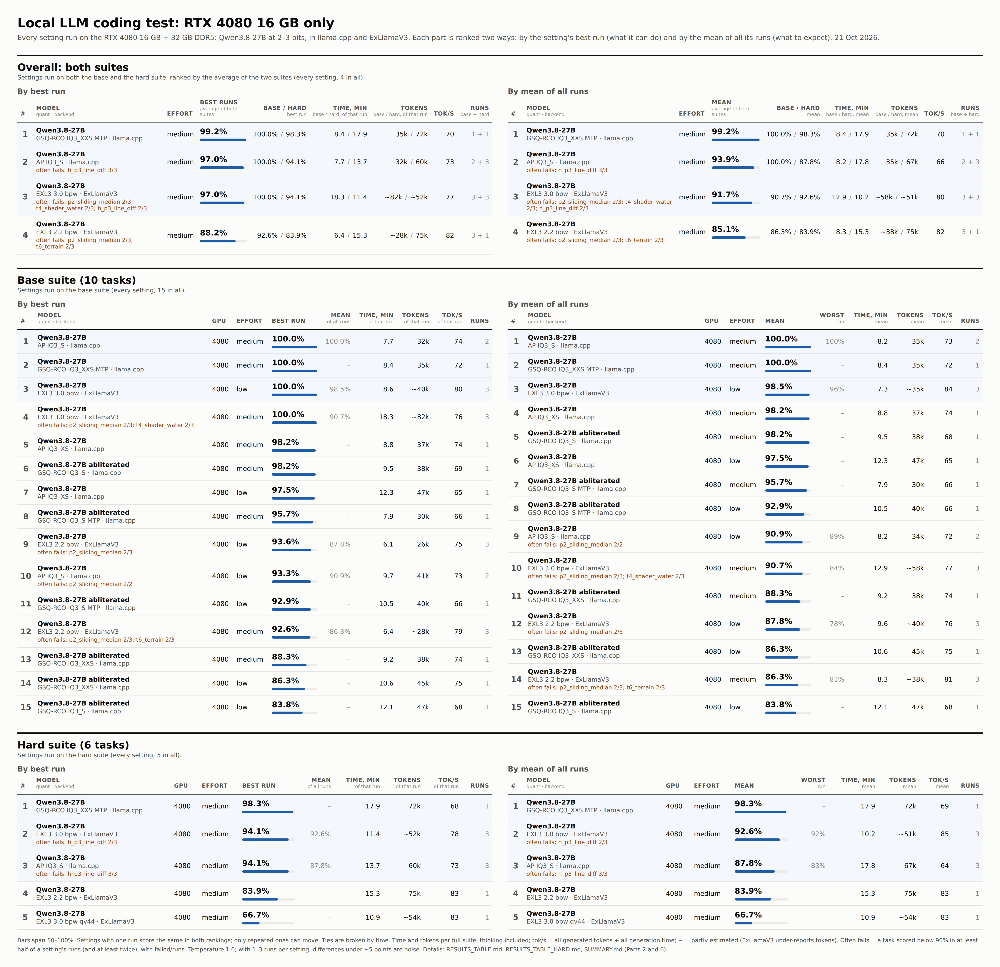
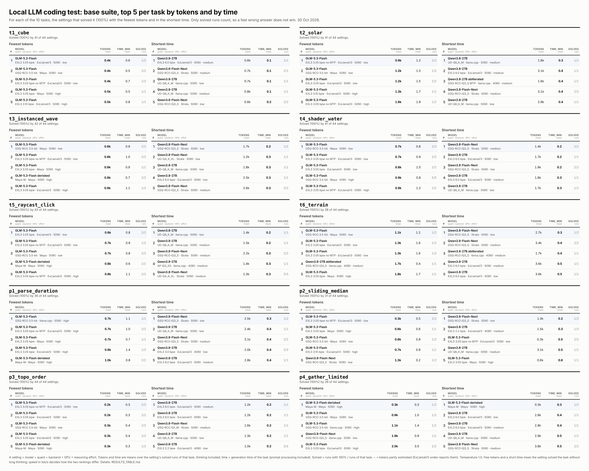
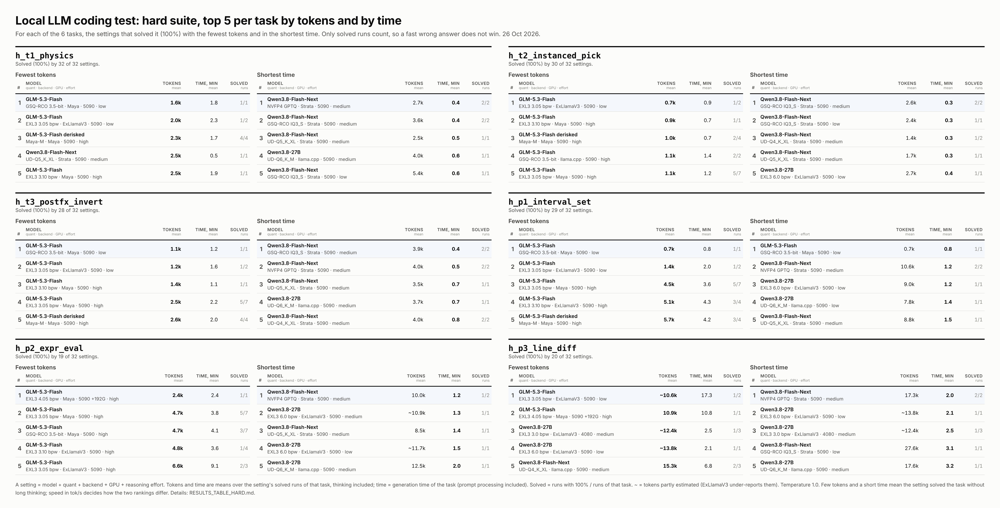
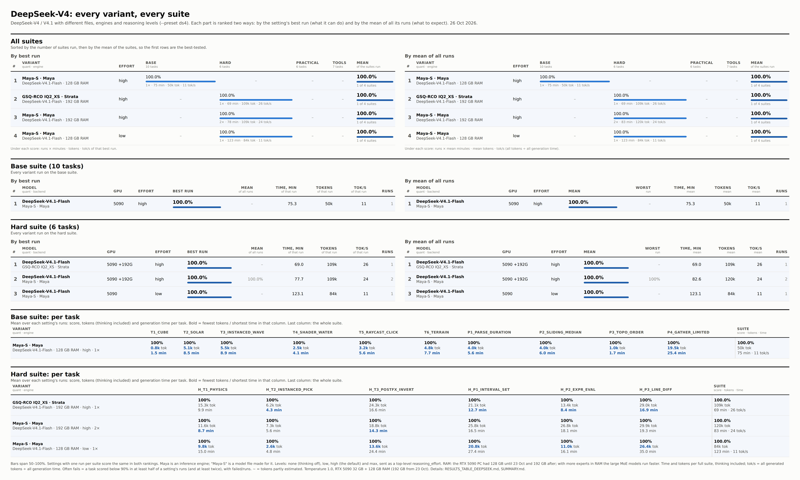
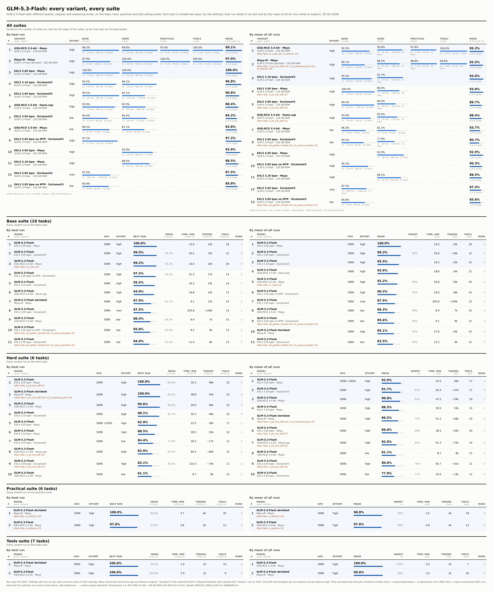
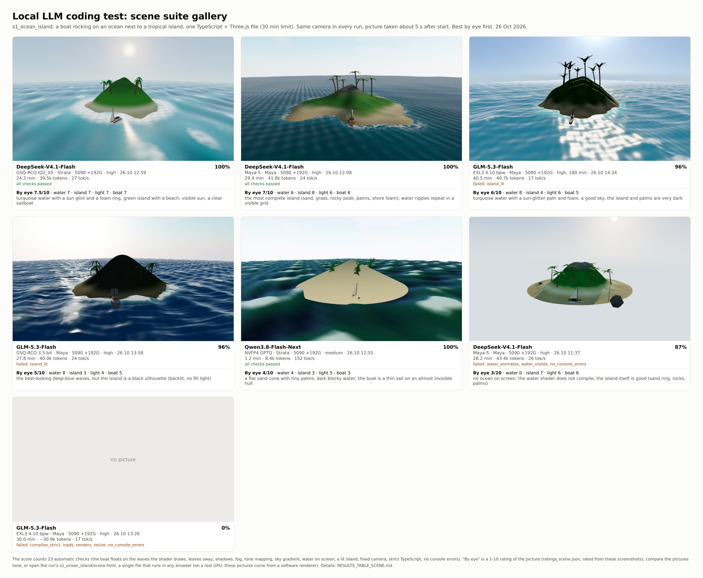

# llm-code-eval — a quick coding test for local LLMs

The repository has six test suites, kept apart everywhere:

| | Base | Hard | Practical | Tools | Scene | Engineering |
|---|---|---|---|---|---|---|
| Tasks | 10: 6 × TypeScript + Three.js, 4 × Python ([tasks.py](tasks.py)) | 6: 3 × Three.js, 3 × Python ([tasks_hard.py](tasks_hard.py)) | 6 everyday jobs: edit, bug fix, refactor, SQL, JSON, long context ([tasks_practical.py](tasks_practical.py)) | 7 tool-calling tasks incl. a small coding agent ([tasks_tools.py](tasks_tools.py)) | 1 large graphics task: boat on an ocean next to an island ([tasks_scene.py](tasks_scene.py)) | 2 physics and mechanics tasks: a Unitas 6497 watch movement, a rocket launch ([tasks_engineering.py](tasks_engineering.py)) |
| Run with | `--suite base` (default) | `--suite hard` | `--suite practical` | `--suite tools` | `--suite scene` | `--suite engineering` |
| Default limits | lenient (comparable with older runs) | lenient | practical | practical | 60 min, 98,304 tokens | 60 min per task, 98,304 tokens |
| Raw results | `results/` | `results_hard/` | `results_practical/` | `results_tools/` | `results_scene/` | `results_engineering/` |
| Tables | [RESULTS_TABLE.md](RESULTS_TABLE.md) | [RESULTS_TABLE_HARD.md](RESULTS_TABLE_HARD.md) | [RESULTS_TABLE_PRACTICAL.md](RESULTS_TABLE_PRACTICAL.md) | [RESULTS_TABLE_TOOLS.md](RESULTS_TABLE_TOOLS.md) | RESULTS_TABLE_SCENE.md, scene_gallery.jpg (after the first run) | RESULTS_TABLE_ENGINEERING.md (after the first run) |
| Compare | `python compare.py` | `--hard` | `--practical` | `--tools` | scene_gallery.jpg | – |

The practical and tool-calling suites are new (11 Oct 2026); so far only GLM-5.3-Flash has been run on them. All GLM-5.3-Flash variants in all suites: [RESULTS_TABLE_GLM.md](RESULTS_TABLE_GLM.md).

Full write-up for both: [SUMMARY.md](SUMMARY.md).


Top 10 settings in three parts: overall (the average of the base and hard suites, settings run on both), the base suite and the hard suite. Each part is ranked two ways side by side: by the setting's best run (what it can do) and by the mean of all its runs (what to expect). The same layout is used for [rtx4080.jpg](rtx4080.jpg) and [glm_flash.jpg](glm_flash.jpg); [top10_hard.jpg](top10_hard.jpg) below repeats the hard-suite part on its own. Regenerate the images (`top10.jpg`, `top10_hard.jpg`, `glm_flash.jpg`, `deepseek.jpg`, `rtx4080.jpg`, `tasks_base.jpg`, `tasks_hard.jpg`) with `python make_top10.py` after new runs; it needs Playwright with Chromium, like `run_eval.py`.

## Base suite: results (25 Sep – 6 Oct 2026)

**The base suite no longer separates the best models: on the RTX 5090 six settings score 100%.** The fastest take about 5 minutes. The reasoning level matters more than the choice of model: Qwen does best at `low`/`medium` (`xhigh` thinks 8× longer on code), GLM does best at `high`.

RTX 5090 32 GB + 128 GB RAM:

| Model | Quant | Backend | Effort | Score | Time | Total tokens | Avg tok/s (from time) |
|---|---|---|---|---|---|---|---|
| Qwen3.8-27B | UD-Q6_K_M | llama.cpp | low | 100.0% | 4.7 min | 28.7k | 108.9 |
| Qwen3.8-27B | EXL3 6.0 bpw | ExLlamaV3 | low | 100.0% | 5.0 min | 30.5k | 108.1 |
| Qwen3.8-Flash-Next | GSQ-RCO IQ3_S | Strata | low (mean of 2 runs) | 95.5% | 5.2 min | 36.2k | 124.5 |
| Qwen3.8-27B | EXL3 6.0 bpw | ExLlamaV3 | medium | 100.0% | 6.5 min | ~42.7k | 114.7 |
| Qwen3.8-Flash-Next | UD-Q4_K_XL | Strata | medium (mean of 3 runs) | 97.3% | 8.2 min | 37.6k | 80.8 |
| GLM-5.3-Flash | EXL3 3.05 bpw | ExLlamaV3 | high (mean of 2 runs) | 99.3% | 25.8 min | ~18.8k | 12.3 |
| Qwen3.8-Flash-Next | GSQ-RCO IQ3_S | llama.cpp | low | 100.0% | 31.3 min | 65.6k | 35.3 |
| Qwen3.8-Flash-Next | GSQ-RCO IQ3_XXS | llama.cpp | medium | 100.0% | 54.6 min | 72.1k | 22.2 |

**RTX 4080 16 GB + 32 GB RAM: Qwen3.8-27B at 3 bits almost matches Q6, at about half the speed.** The best are EXL3 3.0 bpw at `low` and AP IQ3_S at `medium`. Below 3 bits (EXL3 2.2 bpw) the score drops by about 10 points. Scores are means over 2–3 runs.

All 4080 settings: overall (base + hard), base suite and hard suite, each ranked both by best run and by the mean of all runs, with time, tokens, speed and the tasks they keep failing (`python make_top10.py` writes it too):



- **GSQ-RCO IQ3_XXS MTP at `medium` is the best 4080 file, and first overall on any GPU: 99.2%** (base 100% in 8.4 min, hard 98.3% in 17.9 min, about 70 tok/s). This rests on one run per suite (15–16 Oct); repeats will show whether it holds.
- **Next on the 4080 overall, by mean:** AP IQ3_S at `medium` 93.9%, EXL3 3.0 bpw at `medium` 91.7%, EXL3 2.2 bpw at `medium` 85.1%. **By best run** AP IQ3_S and EXL3 3.0 bpw tie at 97.0% (100% base, 94.1% hard): both can do it, but EXL3 3.0 bpw at `medium` drops to 84% on a bad base run and AP IQ3_S fails `h_p3_line_diff` every time.
- **EXL3 3.0 bpw is the steadiest on the hard suite:** 92–94% in 3 runs, about 10 min at 85 tok/s. EXL3 2.2 bpw scored 83.9% (first run, 16 Oct).
- **`h_p3_line_diff` is the 4080's weak spot:** AP IQ3_S fails it in 3 of 3 runs, EXL3 3.0 bpw in 2 of 3. On the base suite the 2–3-bit files keep failing `p2_sliding_median`.

| Model | Quant | Effort | Runs | Mean score | Mean time | Mean tokens | Avg tok/s (from time) |
|---|---|---|---|---|---|---|---|
| Qwen3.8-27B | AP IQ3_S | medium | 2 | 100.0% | 8.2 min | 34.6k | 73.0 |
| Qwen3.8-27B | EXL3 3.0 bpw | low | 3 | 98.5% | 7.3 min | ~34.7k | 83.8 |
| Qwen3.8-27B | EXL3 2.2 bpw | low | 3 | 87.8% | 9.6 min | ~39.6k | 76.2 |

All 68 base-suite runs and per-task scores: [RESULTS_TABLE.md](RESULTS_TABLE.md).

## Hard suite: results (27 Sep – 6 Oct 2026)

**The hard suite separates the models.** It is ranked two ways:
- **by each setting's best run**: what the setting can do on a good run;
- **by the mean of all its runs**: what to expect from it on a typical run.

Settings with one run have the same score in both, so only repeated ones move. On both suites together the best setting is now Qwen3.8-27B GSQ-RCO IQ3_XXS MTP at `medium` on the 16 GB RTX 4080 (99.2%, one run per suite), ahead of Q6 on the 5090 at `medium` (98.1%); see the image above. GLM-5.3-Flash in llama.cpp or ExLlamaV3 hits the 60-minute limit on `h_p3_line_diff` at `high` in 6 of 7 runs.


<!-- hard-ranking:start -->
| # | By best run | Best | Mean | Time (min) | Tokens | tok/s | Runs | Often fails |
|---|---|---|---|---|---|---|---|---|
| 1 | Flash-Next NVFP4 GPTQ · Strata (5090) `medium` | 100.0% | 96.6% | 5.7 | 45k | 137 | 2 | – |
| 2 | Flash-Next UD-Q5_K_XL · Strata (5090) `medium` | 100.0% | 100.0% | 8.0 | 46k | 99 | 1 | – |
| 3 | Flash-Next GSQ-RCO IQ3_S · Strata (5090) `medium` | 100.0% | 100.0% | 19.3 | 181k | 158 | 2 | – |
| 4 | GLM EXL3 3.05 bpw · Maya (5090) `high` | 100.0% | 86.0% | 35.3 | 46k | 22 | 7 | h_p3_line_diff 5/7 |
| 5 | GLM derisked Maya-M · Maya (5090) `high` | 100.0% | 86.5% | 38.8 | 54k | 23 | 4 | h_p3_line_diff 2/4; h_t2_instanced_pick 2/4 |
| 6 | DeepSeek-V4.1-Flash GSQ-RCO IQ2_XS · Strata (5090 +192G) `high` | 100.0% | 100.0% | 53.7 | 83k | 26 | 2 | – |
| 7 | DeepSeek-V4.1-Flash Maya-S · Maya (5090 +192G) `high` | 100.0% | 100.0% | 77.7 | 109k | 24 | 2 | – |
| 8 | DeepSeek-V4.1-Flash Maya-S · Maya (5090) `low` | 100.0% | 100.0% | 123.1 | 84k | 11 | 1 | – |
| 9 | Flash-Next UD-Q4_K_XL · Strata (5090) `medium` | 99.6% | 93.0% | 7.7 | 40k | 90 | 2 | – |
| 10 | GLM GSQ-RCO 3.5-bit · Maya (5090) `high` | 99.6% | 90.8% | 29.9 | 40k | 22 | 7 | – |

| # | By mean of all runs | Mean | Worst | Mean time (min) | Mean tokens | tok/s | Runs | Often fails |
|---|---|---|---|---|---|---|---|---|
| 1 | Flash-Next UD-Q5_K_XL · Strata (5090) `medium` | 100.0% | 100% | 8.0 | 46k | 99 | 1 | – |
| 2 | Flash-Next GSQ-RCO IQ3_S · Strata (5090) `medium` | 100.0% | 100% | 19.6 | 160k | 137 | 2 | – |
| 3 | DeepSeek-V4.1-Flash GSQ-RCO IQ2_XS · Strata (5090 +192G) `high` | 100.0% | 100% | 61.4 | 96k | 26 | 2 | – |
| 4 | DeepSeek-V4.1-Flash Maya-S · Maya (5090 +192G) `high` | 100.0% | 100% | 82.6 | 120k | 24 | 2 | – |
| 5 | DeepSeek-V4.1-Flash Maya-S · Maya (5090) `low` | 100.0% | 100% | 123.1 | 84k | 11 | 1 | – |
| 6 | 27B GSQ-RCO IQ3_XXS MTP (4080) `medium` | 98.3% | 98% | 17.9 | 72k | 69 | 1 | – |
| 7 | Flash-Next GSQ-RCO IQ3_S · Strata (5090) `low` | 97.8% | 98% | 8.4 | 70k | 141 | 1 | – |
| 8 | 27B UD-Q6_K_M (5090) `medium` | 97.6% | 98% | 9.0 | 51k | 96 | 1 | – |
| 9 | Flash-Next NVFP4 GPTQ · Strata (5090) `medium` | 96.6% | 93% | 5.7 | 46k | 139 | 2 | – |
| 10 | 27B EXL3 6.0 bpw · ExLlamaV3 (5090) `low` | 94.4% | 94% | 6.5 | ~46k | 122 | 1 | – |
<!-- hard-ranking:end -->

Time and tokens are per full suite, thinking included: of the best run in the first table, means in the second. tok/s = all generated tokens ÷ all generation time (prompt processing included), the real working speed. **Often fails** = a task scored below 90% in at least half of a setting's runs (and at least twice), as failed/runs; the stability tables in RESULTS_TABLE*.md also say how (wrong answer, time-out, out of tokens). These tables and the GLM table below are written by `make_top10.py`.

- **Flash-Next in Strata leads the hard suite.** Three files reach 100%: NVFP4 GPTQ (5.7 min, the fastest 100% run; its other run 93.2%), UD-Q5_K_XL (8 min, one run) and GSQ-RCO IQ3_S (100% in both runs, about 20 min). GSQ-RCO IQ3_S at `xhigh` (14 Oct) scored only 72.2%.
- **GLM is the clearest case of "good, but not every time".** Four GLM settings have a run at 97–100%, but their means are 86–92%: EXL3 3.05 bpw in Maya ranges over 69–100%.
- **Flash-Next UD-Q4_K_XL** is the same: in Strata its best run is 99.6% and its mean 93.0%; in llama.cpp it drops from 98.1% to 90.3% (worst run 79%).
- **Qwen3.8-27B EXL3 3.0 bpw on the 16 GB card is the steadiest repeated setting:** 92–94% in all three runs.
- **Several of the top settings by mean rest on one run each** (UD-Q5_K_XL, IQ3_XXS MTP, Q6). Repeating them is the most useful next test.

All 65 hard-suite runs and per-task scores: [RESULTS_TABLE_HARD.md](RESULTS_TABLE_HARD.md).

Avg tok/s (from time) = all generated tokens ÷ total generation time. `~` = estimated from the text length: ExLlamaV3 (TabbyAPI) under-reports tokens on long answers, see `fix_token_counts.py`.

## Per task: fewest tokens and shortest time

For every task, the top 5 settings that solved it (100%) with the fewest tokens and in the shortest time. Only solved runs count, so a fast wrong answer does not win; tokens and time are means over the solved runs.





- **Fewest tokens: GLM-5.3-Flash, mostly.** It solves many tasks in 1–5k tokens, often at `low`, but at 11–24 tok/s that still takes minutes.
- **Shortest time: Flash-Next in Strata and Qwen3.8-27B in VRAM.** NVFP4 GPTQ, GSQ-RCO IQ3_S and UD-Q5_K_XL in Strata solve most hard tasks in under a minute, at 100–160 tok/s, even though they think more.
- **`h_p3_line_diff` (minimal diff) is the expensive one:** the cheapest solutions take 10–16k tokens; the fastest take 2–3 minutes (NVFP4 GPTQ in Strata, Qwen3.8-27B EXL3 6.0 bpw).

## DeepSeek-V4: all variants

DeepSeek-V4 / V4.1 has its own table, [RESULTS_TABLE_DEEPSEEK.md](RESULTS_TABLE_DEEPSEEK.md), and its own image in the same layout as GLM (run with `--preset ds4`, see [Running](#running)):



The image ends with a per-task comparison: for every DeepSeek setting, the score, tokens and time of each task (bold = fewest tokens / shortest time in that column).

- **Every DeepSeek-V4.1-Flash run so far scored 100%,** on the base suite (1 run) and on the hard suite (4 runs, `low` and `high`, Maya-S in Maya and GSQ-RCO IQ2_XS in Strata).
- **192 GB of RAM doubled its speed.** With 128 GB it ran at 11 tok/s (base suite 75 min, hard suite at `low` 123 min). With 192 GB (from 23 Oct) it runs at 24–26 tok/s: the hard suite at `high` takes 69–88 min.
- **`low` thinks less, not much less:** 84k tokens on the hard suite against 109–120k at `high`. Per task, `low` used the fewest tokens on every hard task, but on 128 GB it was also the slowest.
- **GSQ-RCO IQ2_XS in Strata is the fastest DeepSeek setting so far:** 69 min and 109k tokens on the hard suite, against 78–88 min and 109–131k for Maya-S in Maya.
- **Still too slow for the practical limits:** with 10 min and 32k tokens per task the hard suite would score 33–50%, because `h_p1`, `h_p2`, `h_t3` and `h_p3` each take 13–30k tokens and 8–35 min.
- **The levels reach the model** (see `--probe-effort` in [Running](#running)): `none` turns thinking off; `low`, `high` and `max` differ little on short questions.

## GLM-5.3-Flash: all variants

GLM-5.3-Flash has its own table across all four suites: [RESULTS_TABLE_GLM.md](RESULTS_TABLE_GLM.md), and its own image (regenerated by `python make_top10.py`):



Summary: mean score (runs, mean time, mean tokens per run, average tok/s). All GLM runs are at `high` unless marked: the GLM chat template has no `medium`, so runs started with `medium` ran at `high` and are listed as `high`.

<!-- glm-table:start -->
| Variant | Effort | Base | Hard | Practical | Tools | Often fails |
|---|---|---|---|---|---|---|
| GSQ-RCO 3.5-bit · Maya | high | **92.2%** (5×, 17 min, 19k, 20 tok/s) | **90.8%** (7×, 47 min, ~54k, 19 tok/s) | **97.6%** (3×, 5 min, 4k, 13 tok/s) | **100.0%** (2×, 3 min, 1k, 7 tok/s) | t1_cube 3/5; w_refactor 3/3 |
| derisked Maya-M · Maya | high | **85.1%** (2×, 18 min, 23k, 23 tok/s) | **86.5%** (4×, 41 min, ~58k, 23 tok/s) | **98.8%** (4×, 4 min, 4k, 19 tok/s) | **99.6%** (4×, 2 min, 1k, 10 tok/s) | h_p3_line_diff 2/4; h_t2_instanced_pick 2/4; w_refactor 2/4 |
| EXL3 3.10 bpw · ExLlamaV3 | high | **95.5%** (1×, 16 min, 13k, 14 tok/s) | **91.7%** (4×, 45 min, ~47k, 17 tok/s) | – | – | – |
| EXL3 3.05 bpw · Maya | high | **100.0%** (1×, 13 min, 14k, 19 tok/s) | **86.0%** (7×, 38 min, ~45k, 20 tok/s) | – | – | h_p3_line_diff 5/7 |
| EXL3 3.05 bpw · ExLlamaV3 | high | **99.3%** (2×, 26 min, ~19k, 12 tok/s) | **80.0%** (3×, 96 min, ~61k, 11 tok/s) | – | – | h_p3_line_diff 3/3 |
| GSQ-RCO 3.5-bit · llama.cpp | high | **93.9%** (1×, 19 min, 14k, 12 tok/s) | **82.9%** (2×, 91 min, ~75k, 14 tok/s) | – | – | h_p3_line_diff 2/2 |
| GSQ-RCO 3.5-bit · Maya | low | **86.3%** (2×, 9 min, 7k, 14 tok/s) | **81.1%** (1×, 9 min, 8k, 15 tok/s) | – | – | – |
| EXL3 3.05 bpw · ExLlamaV3 | low | **83.5%** (2×, 12 min, 9k, 12 tok/s) | **77.9%** (2×, 19 min, ~13k, 12 tok/s) | – | – | p4_gather_limited 2/2; p1_parse_duration 2/2 |
| EXL3 4.05 bpw · Maya (192 GB RAM) | high | – | **92.9%** (1×, 26 min, 26k, 17 tok/s) | – | – | – |
| EXL3 3.05 bpw no MTP · ExLlamaV3 | high | **90.3%** (2×, 24 min, 18k, 14 tok/s) | – | – | – | – |
| EXL3 3.10 bpw · Maya | high | – | **88.5%** (1×, 40 min, 53k, 23 tok/s) | – | – | – |
| EXL3 3.05 bpw · ExLlamaV3 | max | **87.5%** (1×, 206 min, ~159k, 13 tok/s) | – | – | – | – |
| EXL3 3.05 bpw no MTP · ExLlamaV3 | low | **85.6%** (2×, 9 min, 6k, 12 tok/s) | – | – | – | p4_gather_limited 2/2; p1_parse_duration 2/2 |
<!-- glm-table:end -->

- **Maya runs GLM about twice as fast on the hard suite and rarely hits the time limit.** At the same level (`high`):
  - **in Maya:** 38–47 min per run on average; the 60-minute limit on `h_p3_line_diff` was hit once in 18 runs;
  - **in llama.cpp and ExLlamaV3:** 49–96 min, with the limit hit in 6 of 8 runs.
- **Maya also scores a little higher with the older files:**
  - **GSQ-RCO 3.5-bit:** 91.7% in Maya (6 runs; 99.6% on 18 Oct, the best GLM run outside a 100%) against 82.9% in llama.cpp;
  - **EXL3 3.05 bpw:** 86.0% in Maya (7 runs, 69–100%) against 80.0% in ExLlamaV3. In Maya it finishes `h_p3`, but the diff was wrong in 5 of 7 runs.
- **The EXL3 3.10 bpw file is the exception.** In ExLlamaV3 it scored 91.7% over 4 runs (81–98%; 98.1% on 22 Oct in 35 min), solving `h_p3` in 3 of them, the only GLM runs outside Maya to do so at `high`. In Maya (one run, 18 Oct) it scored 88.5%, with the diff wrong. On the base suite it scored 95.5%.
- **New file EXL3 4.05 bpw in Maya (192 GB RAM, 23 Oct):** 92.9% in 25.5 min, the fastest GLM hard run at `high`; it solved `h_p3` in 11 min but lost points on `h_p1_interval_set` (57%).
- **Tasks that keep failing over repeated runs:**
  - **`h_p3_line_diff` (minimal diff) is GLM's weak spot** at `high`. In llama.cpp and ExLlamaV3 3.05 bpw it runs out of time in every run. EXL3 3.05 bpw in Maya finishes it but gets it wrong in 5 of 7 runs.
  - **GSQ-RCO 3.5-bit in Maya** misses `t1_cube` in 3 of 5 base runs and leaves `process_orders` too long in `w_refactor` in 3 of 3 practical runs.
  - **derisked** fails `h_p3_line_diff` and `h_t2_instanced_pick` in 2 of 4 hard runs.
  - **At `low`, EXL3 3.05 bpw** fails `p1_parse_duration` and `p4_gather_limited` in every base run.
- **GLM runs vary a lot.** Three GLM settings have a hard run at 97–100%, but their means are 86–90%.
- **On the base suite GLM scores 85–100%.** The derisked file is the weakest there (85.1%).
- **On the new practical and tool-calling suites GLM is close to perfect.** These tasks need little thinking, so its low speed (11–24 tok/s) matters less: about 2–5 minutes per suite.

## Setup (once)

```
pip install playwright pillow psutil
python -m playwright install chromium
```

You also need Node.js 20+ (`node -v`). On the first run the script installs three, typescript and esbuild into `ts_env/`.

## Running

Serve the model with any OpenAI-compatible server (llama.cpp, TabbyAPI, Strata, Maya, LM Studio, Ollama), then:

```
python run_eval.py --base-url http://localhost:8080/v1 --label qwen-flash-iq3xxs
```

Main options:
- `--label`: short name used in the report (instead of the long model path). Put the model, quant and bpw in it, `-strata` for runs in Strata and `-maya` for runs in Maya (e.g. `qwen27b-UD-Q3_K_XL`, `qwen27b-exl3-3.0bpw`): `make_summary.py` reads them from the name of the results folder, so renaming a folder fixes a wrong label. The GPU is recorded automatically (`nvidia-smi`).
- `--preset qwen-think` / `qwen-instruct` / `glm` / `ds4`: the sampling settings recommended by the model makers
- `--preset ds4` (DeepSeek-V4 / V4.1): temperature 1.0, top_p 1.0. The level is sent the way Maya's own chat sends it: only a top-level `reasoning_effort`, `none` for thinking off (`--think off` or the level `off`), otherwise `low` / `high` / `max` (`high` is the model's default). Add `--template-kwargs` for servers such as llama.cpp that pass the level to the chat template: it also sends `chat_template_kwargs` `{thinking, reasoning_effort}`. With a GGUF, check that the embedded chat template reads `reasoning_effort` (run `--probe-effort` first); some uploads ship an outdated template.
- `--temperature 1.0`: default 1.0; `--top-p`, `--top-k`, `--min-p`, `--presence-penalty`, `--repetition-penalty` override the preset
- `--limits practical` / `lenient`: the time and token limits (see [Limits](#limits)). Default: practical for `--suite practical` and `--suite tools`, lenient for base and hard
- `--max-tokens`, `--task-timeout-min`, `--budget-min`: override single limits (token limit per request, thinking included; minutes per task; minutes for the whole run, 0 = none)
- `--repeat 3`: run the suite 3 times, each as its own run with the same label. The tables then show the mean, the spread and a stability table. With `--temperature 0` it also shows whether the backend gives the same answer every time
- `--think off`: turns thinking off (`enable_thinking=false` in the Qwen/GLM chat template)
- `--reasoning-effort low`: reasoning level (e.g. low / medium / high / xhigh), if the chat template supports it
- `--reasoning-effort off,low,xhigh`: runs the full test once per level, each with its own report
- `CHROMIUM_PATH=/path/to/chrome` (environment variable): use this Chromium build instead of Playwright's own; `make_top10.py` reads it too
- `--max-completion-tokens N`: also sends `max_completion_tokens` (the newer name for the same budget), to test whether a server reads it for the thinking limit (see Part 9 of SUMMARY.md)
- `--show-request`: print each request's settings (everything but the messages), to see exactly which thinking and effort fields the server gets.
- `--probe-effort`: quick probe. It asks one short question at each level (levels follow the preset: GLM and DeepSeek-V4 `off,low,high,max`, Qwen `off,low,medium,xhigh`; or give your own, weakest first) and shows how long the model thinks and whether the server honours the level. 3 tries per level by default (`--probe-repeats`); `--probe-question hard` uses a harder question where the level matters more.
- `--suite hard` / `practical` / `tools`: run another suite instead of the base one (see the task sections below)
- `--only three` / `--only python`, `--tasks t5_raycast_click`: run only some tasks

| Preset | Settings |
|---|---|
| qwen-think | temperature 1.0, top_p 0.95, top_k 20, min_p 0, presence_penalty 0, repetition_penalty 1.0 |
| qwen-instruct | temperature 0.7, top_p 0.80, top_k 20, min_p 0, presence_penalty 1.5, repetition_penalty 1.0 (use with `--think off`) |
| glm | temperature 1.0, top_p 1.0 |

At temperature 1.0 results vary between runs (up to ~19 points so far). For comparisons use `--repeat 3`.

Memory measurement needs `psutil`; VRAM is read from `nvidia-smi`.

Compare runs (latest run per name; `--all` shows every run):

```
python compare.py               # base suite
python compare.py --hard        # hard suite
python compare.py --practical   # practical suite
python compare.py --tools       # tool-calling suite
```

Rebuild the result tables of all suites from the data:

```
python make_summary.py
```

Runs made with an older `run_eval.py` against ExLlamaV3 (TabbyAPI) may have token counts that are far too low. Run `python fix_token_counts.py` once to re-estimate them from the saved text; it keeps the server's numbers and is safe to run again.

## Limits

The limits decide what counts as a useful answer. A local model that thinks for 40 minutes about one function is not useful in daily work, even if it gets it right in the end. What the runs so far show (688 tasks, base and hard suites):

| Per task | Tasks | Fully solved |
|---|---|---|
| under 2 min | 529 | 85% |
| 2–10 min | 120 | 65% |
| 10–20 min | 14 | 86% |
| over 20 min | 25 | 56% |
| under 8k tokens | 572 | 85% |
| 8k–32k tokens | 87 | 63% |
| over 32k tokens | 29 | 48% |

95% of the fully solved tasks took under 10 minutes and under 19k tokens. Past 32k tokens the model is usually lost or looping. So:

| Profile | Per task | Tokens per task | Whole run | Default for |
|---|---|---|---|---|
| **practical** | 10 min (tool tasks: 5 min for all turns) | 32,768 | base 30 min, hard 30 min, practical 30 min, tools 15 min | `practical`, `tools` |
| lenient | 60 min | 98,304 | none | `base`, `hard` (so new runs stay comparable with the old ones) |
| engineering suite | 120 min | 196,608 | 245 min | `engineering` (two large tasks) |
| scene suite | 60 min | 98,304 | 65 min | `scene` (one large task; the 30-min runs were cut off while still working) |

The whole battery (all four suites) then takes at most about 1 h 45 min; a usable setup finishes it in 30–45 minutes. The tables also show **Score @10 min/32k** for every setting: the score with the practical limits applied after the fact to runs made with the lenient ones (later tasks count as 0). Dense Qwen3.8-27B keeps its score; Flash-Next in llama.cpp and GLM lose 8–25 points.

`w_longctx` sends about 25k tokens of code, so the server needs a context of at least prompt + `--max-tokens`, i.e. 64k with the practical limits.

## What is measured

- score and status of every task: `ok`, `max_tokens` (ran out of tokens), `task_timeout`, `no_answer` (stopped while still thinking), `max_turns` (tool tasks: no final answer), `server_crash`, `server_down`
- **broken generations**: tasks where generation itself failed (out of tokens or time, stopped mid-thought, a loop, no final answer), shown as a share in the tables
- **stability** for settings run 2+ times (`--repeat`): mean, standard deviation, worst run, tasks solved in every run, identical answers
- "fin.": average score over the tasks the model finished (separates quality from speed)
- time, tokens (including thinking tokens), generation speed (tok/s), time to first token
- peak VRAM and RAM, and how many GB were read from disk during the run
- the model's thinking is saved as `reasoning.md` next to its answer

## Base suite: tasks

Every Three.js task (in both suites) must:
- compile with `tsc --strict`
- load in the browser without console errors
- actually draw something (not a blank colour)
- handle window resizing
- pass its own checks (e.g. the cube rotates, a click selects the right cube, terrain normals point up)

| Task | What it tests |
|---|---|
| t1_cube | basics: scene, lights, delta-time animation |
| t2_solar | object hierarchy, orbits, PointLight |
| t3_instanced_wave | InstancedMesh with 10,000 cubes, performance |
| t4_shader_water | custom ShaderMaterial, GLSL, uniforms |
| t5_raycast_click | Raycaster, mouse clicks, selection state |
| t6_terrain | hand-built BufferGeometry, indices, winding order, OrbitControls from addons |

Python tasks have hidden tests (correctness + performance):

| Task | What it tests |
|---|---|
| p1_parse_duration | reading a spec carefully, edge cases |
| p2_sliding_median | algorithm + performance (200k items) |
| p3_topo_order | graphs, lexicographically smallest order, cycles |
| p4_gather_limited | asyncio: concurrency limit, ordering, cancellation on error |

## Hard suite: tasks

6 harder tasks to separate the models that score about 100% on the base suite. They live in `tasks_hard.py`, runs are saved to `results_hard/` and the run name gets a `-HARD` suffix. The Three.js tasks are checked the same way as in the base suite (plus their own checks below); the Python tasks have hidden tests.

| Task | What it tests |
|---|---|
| h_t1_physics | 20 balls in a box: mass-aware elastic collisions, energy conservation, no overlap; the test calls `step()` 600 times itself |
| h_t2_instanced_pick | 900 instances in one InstancedMesh, clicks toggle colour, also checked on screen (did the colour reach the GPU) |
| h_t3_postfx_invert | EffectComposer + custom colour-inverting shader; the on-screen result must be correct in sRGB (pass order) |
| h_p1_interval_set | interval set: merging, splitting, edge cases, O(log n) performance |
| h_p2_expr_eval | exact calculator: precedence, right-associative `^`, unary minus, functions, errors; 400 random expressions |
| h_p3_line_diff | minimal diff (LCS) with repeated lines; performance needs Myers' algorithm |

Examples:

```
python run_eval.py --suite hard --label qwen27b-q6 --preset qwen-think --reasoning-effort low,medium
python run_eval.py --suite hard --label glm-exl3 --preset glm --reasoning-effort high
python run_eval.py --label DeepSeek-V4.1-Flash-Maya-S --preset ds4 --probe-effort --probe-question hard   # check the levels first
python run_eval.py --suite hard --label DeepSeek-V4-Flash-UD-IQ2_M --preset ds4 --reasoning-effort off,high,max
python compare.py --hard
```

## Practical suite: tasks

Everyday work on existing code rather than writing from scratch. All graded by hidden Python tests.

| Task | What it tests |
|---|---|
| w_edit | add a parameter and a function to an existing module; the rest of the file must stay byte-for-byte the same (checked per function on the syntax tree) |
| w_bugfix | fix two bugs from a CI failure (failing test + assertion), checked on hidden cases too |
| w_refactor | split a 50-line function into three helpers; same results on 43 inputs, short main function |
| w_sql | four SQLite queries (top customers, monthly revenue, never paid, average per country), run on hidden data |
| w_json | extract 6 records from customer messages into JSON that matches a schema (structured output) |
| w_longctx | find the cause of a bug report in a ~25k-token module and return only the fixed function (long context) |

## Tool-calling suite: tasks

The model gets OpenAI-style `tools` for a fake shop backend; `run_eval.py` executes every call against fake data (no network, no real side effects) and sends the result back, until the model answers without a tool. Graded on which tools were called, with what arguments, and what the final answer says.

| Task | What it tests |
|---|---|
| t_select | the right tool out of 10 similar ones, no needless calls, nothing that changes data |
| t_args | arguments that match the schema: enum, date format, integer id, array of tags, short title |
| t_chain | 3 dependent calls: find the customer by email (a similar name is a trap), their latest order, refund it in full |
| t_parallel | three independent lookups in one turn instead of one by one |
| t_error | the service fails once with a 503 (retry), and an order does not exist (say so, do not invent a status) |
| t_no_tool | a question that needs no tool: no call, a short answer |
| t_agent_fix | coding agent: `list_files`, `read_file`, `write_file`, `run_tests` on a small repo with 2 bugs; the tests must pass, also hidden ones, the test file must stay unchanged, at most 12 tool calls |

Every tool task also checks that the calls are well-formed (valid JSON, not written as text) and that a final answer came. The server must support tool calls: llama.cpp needs `--jinja` and a chat template with tools; TabbyAPI has its own tool-call support; for other servers check their docs. A model or server that cannot call tools scores close to 0 here, which is the point.

## Scene suite: results (26 Oct 2026)



All on the RTX 5090 + 192 GB RAM, one run each. Table: [RESULTS_TABLE_SCENE.md](RESULTS_TABLE_SCENE.md); every run's finished scene is `results_scene/<run>/s1_ocean_island/scene.html`.

| Model · quant · engine | Effort | Score | By eye | Time | Tokens (thinking) | Picture |
|---|---|---|---|---|---|---|
| DeepSeek-V4.1-Flash EXL2 2.9 bpw · Maya | high | 100% | **7.5** | 30.2 min | 41.6k (32.8k) | clean turquoise water with foam rings, sand beach, green hill, palms; sailboat with a rectangular sail |
| DeepSeek-V4.1-Flash GSQ-RCO IQ2_XS · Strata | high | 100% | **7.5** | 24.3 min | 39.5k (32.8k) | turquoise water with a sun glint and foam, green island with a beach, a clear sailboat |
| DeepSeek-V4.1-Flash Maya-S · Maya | high | 100% | **7** | 29.4 min | 41.8k (32.8k) | the most complete island (sand, grass, rocky peak, palms, foam); water ripples repeat in a grid |
| DeepSeek-V4.1-Flash EXL2 2.9 bpw · Maya | low | 100% | **6.5** | 28.0 min | 40.1k (32.8k) | sun glint and foam rings around the island; palm crowns look bushy and odd |
| DeepSeek-V4.1-Flash EXL2 2.9 bpw · Maya | max, 60 min | 100% | **7.5** | 44.5 min | 60.0k (51.2k) | teal water with soft ripples and a sun glint; sand-and-green island with palms; a clear sailboat |
| DeepSeek-V4.1-Flash Maya-S · Maya | max, 60 min | 96% | **7** | 45.5 min | 60.2k (50.8k) | sand beach and green island with palms and rocks; sun glints on the water; the boat is small |
| GLM-5.3-Flash EXL3 4.10 bpw · Maya | high, 180 min | 96% | **6** | 40.5 min | 40.7k (32.8k) | the best water (glitter path, foam) and sky; island and palms very dark |
| GLM-5.3-Flash GSQ-RCO 3.5-bit · Maya | high | 96% | **5** | 27.8 min | 40.0k (32.8k) | beautiful deep-blue waves; the island is a black silhouette |
| Qwen3.8-Flash-Next NVFP4 GPTQ · Strata | medium | 100% | **4** | **1.2 min** | 8.4k (1.6k) | a flat sand cone, blocky water, a barely visible boat |
| DeepSeek-V4.1-Flash Maya-S · Maya (1st run) | high | 87% | **3** | 28.2 min | 43.4k (32.8k) | no ocean: the water shader does not compile (`vec2.z`) |

- **The score alone does not separate the good scenes,** so each run also has a by-eye rating, 1–10 for water, island, light and boat ([ratings_scene.json](ratings_scene.json), rated from the gallery screenshots; edit it if you see it differently). Two checks were added after the first runs (`water_visible`, `island_lit`) and the saved answers were graded again: the scene without water fell from 90% to 87%, the two GLM scenes with a black island to 96%.
- **Two more DeepSeek-V4.1 runs on a different file (EXL2 2.9 bpw, Maya, 26 Oct, both at 100%):** `low` finished in 28.0 min (6.5 by eye), `high` in 30.2 min (7.5 by eye). Their thinking stopped at 32.8k tokens again (32,781 and 32,796), so `low` and `high` used almost the same number of tokens (40.1k and 41.6k): with the cap, the level barely changes this task.
- **DeepSeek-V4.1 made the best scenes** (7–7.5 by eye), GLM-5.3 the best water but dark islands (5–6), Qwen3.8-Flash-Next NVFP4 the fastest and simplest (4).
- **Qwen3.8-Flash-Next NVFP4 in Strata did it in 1.2 min**, 20–30 times faster than the others, but its picture is the weakest of the finished ones.
- **Thinking stopped at about 32.8k tokens in the 30-minute runs** (32,776–32,798), then the model wrote the answer. See SUMMARY.md, Part 9. Four DeepSeek runs of 26–27 Oct with a 60-minute limit thought 51k–63k tokens instead, so the cap was not there for them. The cause is not yet known.

## Scene suite: task

One larger Three.js task where the picture matters, for telling the strongest settings apart now that several of them score 100% on the hard suite. Run it with `--suite scene` (30 min and 98,304 tokens for the task). The browser window is 1280 x 720.

**s1_ocean_island:** a boat rocking on an ocean next to a tropical island, built from scratch (no textures or models):
- an ocean of at least 3 waves in a vertex shader, with Fresnel, a sun highlight and foam as a plus;
- a boat (at least 3 meshes) whose height and tilt follow the same waves;
- a procedural island with sand and grass and at least 5 palm trees whose leaves (one InstancedMesh) sway in the wind;
- a sky with a sun, a shadow-casting sun light, fog and filmic tone mapping;
- a fixed camera at (35, 12, 35) looking at (0, 2, 0), so every run is shot from the same place.

**What the score checks (23 checks):** the usual strict TypeScript, loads, renders, resize and no console errors, plus:
- **the waves:** `__ocean.heightAt(x, z, t)` and `__ocean.time()` exist, the waves move and are big enough to see;
- **the boat really floats on them:** over 3 s its height follows `heightAt` at its position with a constant offset (to within a fifth of how far it moves), it tilts, it has at least 3 meshes and casts shadows. A boat on its own sine wave, or a `heightAt` that does not match the shader, fails;
- **the palms:** at least 30 leaf instances whose matrices change over time;
- **the island:** 4–20 units high, at least 20 units across, centered, receives shadows;
- **light and camera:** shadow map and a shadow-casting sun, fog plus tone mapping, the camera where it should be;
- **the picture:** a sky gradient at the top, water that is on screen (the bottom quarter is not a flat background) and moves, a lit island (not a near-black silhouette where it lands on screen), a rich image (not a few flat colors).

**Without the time limit.** A slow model may not finish in the time limit (the run then ends with `task_timeout`; such a run without a scene is removed, not kept in the table). To see what it makes given time, run it again with `--task-timeout-min 180 --budget-min 0`; if the task then takes longer than 30 min, the tables list that run as a separate setting (effort shown as e.g. `high, 180 min`), so it does not mix with the 30-minute runs; a run that still finishes within 30 min counts as a normal run.

**How it looks is not in the score.** Every run saves:
- `screenshot.png`, `screenshot_2.png` and `screenshot_3.png` (about 1, 3 and 6 s after start);
- **`scene.html`: the finished scene in one file** (the bundle with Three.js inlined, about 0.6 MB). Open it by double-click in any browser to watch it on a real GPU.

`python make_top10.py` builds **scene_gallery.jpg** from all scene runs: the same view side by side, with the score, time, tokens and failed checks under each picture. The pictures come from Chromium's software renderer, so they can look slightly worse than `scene.html` on a GPU.

The boat is sampled inside `renderer.render`, so its position and `__ocean.time()` belong to the same frame even when the software renderer runs at 1 frame per second; motion checks wait long enough for a frame. `python regrade.py --suite scene --tasks s1_ocean_island` builds and checks the saved `main.ts` files again after a change to the checks.

The checks were tested with a reference solution ([reference/s1_ocean_island.ts](reference/s1_ocean_island.ts), 23 of 23) and with broken versions of it: a boat on its own sine wave, leaves that do not move, and a `heightAt` that does not match the shader each lose the right checks.

## Engineering suite: tasks

Two Three.js tasks that test physics and mechanics, not only the picture. Run with `--suite engineering` (120 min and 196,608 tokens per task, 1280 x 720; slow setups at about 25 tok/s need that much). Each run saves a `scene.html` per task, like the scene suite. The checks read the simulation through hooks, so they test the numbers:

**e1_watch_unitas:** a hand-wound ETA/Unitas 6497-1 movement (17 jewels, 18,000 vibrations per hour = 5 beats per second) that works as a mechanism, with simplified shapes. Real toothed wheels (extruded shapes) and pinions: barrel → center wheel (1 turn per hour) → third → fourth (1 turn per minute) → escape wheel. The fork flips each time the balance passes its centre, and only then the escape wheel moves half a tooth (12°, one turn per 6 s), so the whole train moves in small jumps, 5 per second. It starts assembled and running; E or a button animates the exploded view. At least 40 named parts with labels. It must look as realistic as possible, like a macro photograph: physically based materials with reflections, Geneva stripes on the bridges, perlage on the plate, polished bevels, heat-blued screws, ruby jewels in gold chatons, a blued hairspring, engraving, studio lighting (all procedural, no downloaded textures). Checks (22):
- **balance:** 2.5 Hz (±2%, measured from 20 s of simulated time), amplitude 180–360°, no decay;
- **escapement:** the 15-tooth escape wheel moves half a tooth per beat; the pallet fork flips 5 times a second, each time within 0.03 s of the balance passing its centre; the escape wheel moves only on those beats;
- **gear train:** tooth counts in `userData` give center→fourth 60:1, fourth→escape 10:1, barrel→center 4–10:1; with `explode(0)` each wheel's axis sits at wheel radius + next pinion radius from the next one (the teeth mesh, ±15%); all wheels turn together with the right ratios, meshing wheels in opposite directions; seconds hand one turn per 60 s, minute hand per hour, hour hand per 12 h;
- **parts:** at least 40 with unique names, the 17 jewels (`jewel_1` ... `jewel_17`), `explode(0)` assembles and `explode(1)` separates them, and the parts are lit and visible;
- strict TypeScript, loads, renders, resize, no console errors.

**e2_rocket_launch:** a Falcon-9-like launch from Cape Canaveral, driven by a physics model (thrust-to-weight 1.3, a 200 s burn with the mass falling from 550 t to 220 t, gravity falling with altitude, a gravity turn). It must look as realistic as possible, like a launch photograph (physically based materials, sun shadows, atmospheric scattering, aerial perspective, bloom on the flame, procedural textures): the Florida coast with scrub, roads, low buildings and the Atlantic behind the pad, haze, a concrete pad with a flame trench, a lattice tower and lightning masts, a white rocket with an interstage, nozzles and markings, a white-hot flame core fading to orange, a flickering light from the plume, and soft billowing steam and smoke rolling sideways out of the trench. The camera is low near the pad at liftoff, then a long lens tracks the rocket. Checks (16):
- **physics:** net acceleration at liftoff 0.1–0.6 g, vertical at the start, a pitch that only grows after 10 s and reaches 0.3–1.57 rad at 150 s, acceleration growing as the propellant burns, 100 km reached;
- **pictures:** an orange or yellow plume at 2 s and its white-hot core (`plume_t2.png`), white steam and smoke clouds at the pad at 4 s (at least 3% of the lower half, `smoke_t4.png`), a dark sky with stars above 100 km (`karman.png`), a trail of at least 50 points;
- strict TypeScript, loads, renders, resize, no console errors.

The realism itself (the watch finishes and materials; the coast, the tower, how soft the smoke looks) cannot be measured; both tasks will be rated by eye from the saved pictures, like the scene suite. The references only show that the checks can be passed; they are not meant to look realistic.

Both checks were tested on reference solutions ([reference/e1_watch_unitas.ts](reference/e1_watch_unitas.ts), 22 of 22; [reference/e2_rocket_launch.ts](reference/e2_rocket_launch.ts), 16 of 16) and on broken versions: a 3 Hz balance, a smooth escape wheel without ticks, a full tooth per beat, a balance that passes its centre off the beat (cos instead of sin), wheels that do not mesh, meshing wheels turning the same way, an hour hand at the minute hand's speed, parts that do not separate, no gravity turn, thrust-to-weight 2.5, a constant mass and a sky that stays blue. Each lost the right checks.

## Comparing with other APIs and harnesses

[prompts/](prompts/) has the three large graphics tasks (island, watch, rocket) as plain prompts, to run in another API, a chat or an agent harness (Claude Code, Codex, Cursor and the like). Each `.md` has the system and the user prompt, the build setup and how to save the answer; `.system.txt` and `.user.txt` hold the plain text for an API call. They are generated from the task files by `python make_prompts.py`, so they always match what the local models get.

Grade the answers like a local run, without a server; they go to the same tables and gallery:

```
python run_eval.py --suite engineering --from-file answers/ --label Claude-Opus-5.5-web
```

`answers/` holds `<task_id>.md` (a whole chat reply) or `<task_id>.ts` (the file an agent wrote), and optionally `<task_id>.json` with `{"minutes": ..., "tokens": ..., "reasoning_tokens": ...}`. A single file works too, with `--tasks <task_id>`.

## Output

Each run is saved to `results/<date>_<name>/` (base suite), `results_hard/<date>_<name>-HARD/`, `results_practical/<date>_<name>-PRACTICAL/`, `results_tools/<date>_<name>-TOOLS/` or `results_scene/<date>_<name>-SCENE/`:
- `report.md`: what passed, what failed and why
- `summary.json`: numbers for comparisons
- one folder per task with the model's full answer, its code, its thinking and `screenshot.png`; tool tasks also have `transcript.json` (every call and result) and, for the agent task, the repository it edited

`make_summary.py` also writes `results_table.csv` into each results folder.

## Tips

- Use the preset recommended for the model.
- Thinking models can write for a very long time. If time runs out, lower the reasoning level, turn thinking off or lower `--max-tokens`.
- Tasks and tests live in `tasks.py`, `tasks_hard.py`, `tasks_practical.py` and `tasks_tools.py`; adding your own is easy.
- A full battery with useful limits: `--suite base`, `hard`, `practical`, `tools`, each with `--limits practical --repeat 2`.
